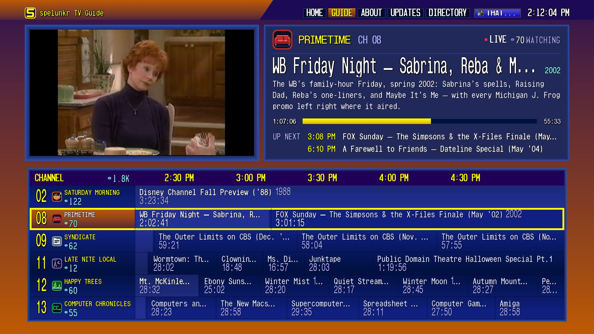

# Spelunkr for webOS

An independent, native webOS application for LG TVs, using the original Spelunkr website interface with Magic Remote controls. No Android runtime or separate LAN server is required.



*Actual 1080p capture from an LG webOS TV, including the playing channel.*

## Install with Homebrew Channel

Requires [Homebrew Channel](https://www.webosbrew.org/) already installed on your TV.

1. Open Homebrew Channel → Settings → Add repository.
2. Enter this custom repository URL:

   ```text
   https://raw.githubusercontent.com/Nikolay1243/spelunkr-webos/main/homebrew/apps.json
   ```

3. Refresh the app list, select **Spelunkr**, and choose **Install**. Use the same listing for updates.

This is a custom repository, not a listing in the default Homebrew catalog.

## Install the release package manually

Download the `.ipk` from [Releases](https://github.com/Nikolay1243/spelunkr-webos/releases/latest). Install it with [webOS Dev Manager](https://github.com/webosbrew/dev-manager-desktop) after connecting your TV, or use the webOS CLI:

```sh
ares-setup-device
# Add your TV using its IP address and your Developer Mode or rooted SSH configuration.
ares-install --device YOUR_TV tv.spelunkr.webos_0.3.7_all.ipk
ares-launch --device YOUR_TV tv.spelunkr.webos
```

Developer Mode installations require Developer Mode to remain enabled. Homebrew Channel installations require a TV configured for Homebrew. Tested on webOS 9.2.2 and on webOS 6.5.3 (LG C1, Chromium 79); older versions have not been validated.

## Remote controls

| Control | Guide | Fullscreen video |
| --- | --- | --- |
| Arrows | Browse channels and controls | Up/Down opens the video menu |
| OK | Tune the selected channel | Activate the focused menu control |
| CH + / − | Page the guide and move selection | Change channel |
| Back | Navigate back | Show menu, then return to guide on the next press |
| Hold OK for 2 seconds | — | Spelunk, while the menu is hidden |

Browsing the guide keeps your active channel playing until you press OK. Video preserves its aspect ratio, including 4:3 material. Releasing OK early cancels the Spelunk progress indicator. A quick OK press with the video menu hidden does nothing.

## Discord sign-in

Choose **Sign In** and complete Discord’s login and authorization on the TV. The app retains the session locally. Do not share passwords, authorization codes, or session data.

The packaged authentication helper currently requires the webOS app-debugging endpoint on TV localhost port 9998. Sign-in was validated on the development TV with that endpoint available; installations without it may play normally but cannot complete this sign-in flow. The helper follows only this app’s OAuth callback and returns it to the app; no companion server is used.

## Build from source

Use Node.js 22 or newer and a webOS CLI providing `ares-package` (the development build used `@webosose/ares-cli`).

```sh
npm ci
npm run sync:site
npm test
npm run package
```

The package is written to `output/`. `sync:site` downloads the pinned public website assets and verifies their SHA-256 hashes. Those downloaded assets, generated packages, local credentials, and development experiments are excluded from Git.

The bundle is built for `chrome79` on purpose. webOS 6.x (LG C1 and older) ships Chromium 79, which cannot parse nullish coalescing or optional chaining: one such token makes the browser discard the whole `app.js` with a `SyntaxError` before any of it runs, and the app then sits on its `PLEASE STAND BY` placeholder with nothing in the UI to explain it. `scripts/build.mjs` therefore targets `chrome79`, appends the runtime shims in `src/legacy-shims.js` (`structuredClone`, `crypto.randomUUID` — APIs that cannot be transpiled), and fails the build if `dist/app.js` is not ES2019-parseable. Raising the target past `chrome79` breaks every pre-webOS-7 TV.

```sh
npm run dev                 # Local preview; TV services require a TV
npm run sync:site:latest    # Explicitly update upstream asset pins; review adapters afterward
npm run release:prepare     # Package, Homebrew manifest, and SHA256SUMS
```

The Homebrew listing points at the latest release manifest. Release assets include the IPK, manifest, and checksums. Publish matching source and package versions together.

## Source and attribution

This is a separate project, not a fork of the Android app. It packages public production client assets from [spelunkr.tv](https://spelunkr.tv), with webOS navigation, playback geometry, remote controls, and an authentication service. The upstream client source repository has not been located.

Original Spelunkr code, artwork, styling, branding, and programming remain upstream material; this repository does not grant a license to those materials. See [PROVENANCE.md](PROVENANCE.md) and [the pinned asset inventory](upstream/site-manifest.json). The bundled `ws` dependency includes its MIT license in `service/ws-LICENSE.txt`.
